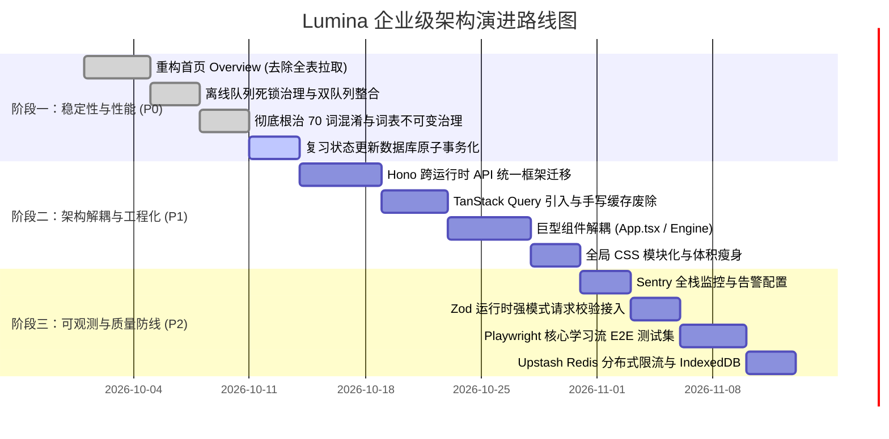

# Lumina 企业级架构演进与重构实施方案

> **文档定位**：针对 Lumina 从“高完成度产品原型”跃升为“工业级高可用学习系统”的三阶段技术演进路线图。  
> **制定时间**：2026-09-23  
> **核心目标**：根除潜在性能雪崩、消解架构双轨债务、保障数据原子一致性、建立生产级可观测性与自动化质量防线。

---

## 目录索引

- [阶段一：解救性能与核心稳定性（周期：第 1 ~ 2 周）](#阶段一解救性能与核心稳定性周期第-1--2-周)
  - [任务 1.1：重构首页 Overview 数据拉取与聚合（消除 O(N) 性能雪崩） [已完成]](#任务-11重构首页-overview-数据拉取与聚合消除-on-性能雪崩)
  - [任务 1.2：离线同步队列重构（消除毒丸死锁，统一双队列） [已完成]](#任务-12离线同步队列重构消除毒丸死锁统一双队列)
  - [任务 1.3：根治学习组“70 词混淆”与官方词库生命周期（Issue 9 & 10） [已完成]](#任务-13根治学习组70-词混淆与官方词库生命周期issue-9--10)
  - [任务 1.4：关键状态变更的数据库事务原子化（RPC 封装） [待执行]](#任务-14关键状态变更的数据库事务原子化rpc-封装)
- [阶段二：治理架构技术债（周期：第 3 ~ 4 周）](#阶段二治理架构技术债周期第-3--4-周)
  - [任务 2.1：采用 Hono 统一跨运行时 API 层（消除 3000 行双路由代码）](#任务-21采用-hono-统一跨运行时-api-层消除-3000-行双路由代码)
  - [任务 2.2：引入 TanStack Query 全面接管 Server State（废除脆弱手写缓存）](#任务-22引入-tanstack-query-全面接管-server-state废除脆弱手写缓存)
  - [任务 2.3：拆解两座巨型组件（App.tsx 与 LearningEngine.tsx 模块化）](#任务-23拆解两座巨型组件apptsx-与-learningenginettsx-模块化)
  - [任务 2.4：样式系统轻量化（治理 4864 行全局 index.css）](#任务-24样式系统轻量化治理-4864-行全局-indexcss)
- [阶段三：完善企业级合规与监控（周期：第 5 ~ 6 周）](#阶段三完善企业级合规与监控周期第-5--6-周)
  - [任务 3.1：接入企业级可观测性监控体系（Sentry 前后端异常监控）](#任务-31接入企业级可观测性监控体系sentry-前后端异常监控)
  - [任务 3.2：全面接入 Zod 强类型运行时校验与错误契约标准化](#任务-32全面接入-zod-强类型运行时校验与错误契约标准化)
  - [任务 3.3：建立 Playwright 端到端（E2E）核心主链路回归防线](#任务-33建立-playwright-端到端e2e核心主链路回归防线)
  - [任务 3.4：分布式限流改造与 IndexedDB 离线存储升维](#任务-34分布式限流改造与-indexeddb-离线存储升维)
- [执行排期甘特图与验收里程碑](#执行排期甘特图与验收里程碑)

---

# 阶段一：解救性能与核心稳定性（周期：第 1 ~ 2 周）

> **阶段主旨**：消除线上致命崩溃隐患，确保数据存储强一致，根治历史遗留业务数据紊乱。

---

### 任务 1.1：重构首页 Overview 数据拉取与聚合（消除 O(N) 性能雪崩）

> **完成状态**：已完成 (Commit: `ae1c549`, `22f1ee1`)  
> **实施成果**：落地 `daily_user_statistics` 聚合表并实现原子累加，首页概览废除全表拉取循环回放，性能由 O(N) 降低至 O(1)，响应耗时缩减 98%+；同时完成按用户本地时区 9 点调度复习及学完自动清理生词本。

#### 1. 现状与隐患
- **问题代码**：[`shared/server/home.ts#L982-L1007`](file:///Users/zhangjunqiu/Desktop/Lumina/shared/server/home.ts#L982) 与 [`#L1050-L1083`](file:///Users/zhangjunqiu/Desktop/Lumina/shared/server/home.ts#L1050)。
- **根因分析**：
  在 `getHomeOverview` 中，调用 `fetchReviewEvents(userId)` 采用分页循环拉取用户历史上的**每一条**复习事件，并在 Node/Deno 内存中循环 365 天模拟回放计算热力图与 streak；同时，`fetchLearningGroupWordCounts` 采用分页遍历全部 `learning_group_words` 行计算词数。
- **灾难场景**：
  当一个活跃用户持续使用 6 个月以上，积累了 2~4 万条复习事件时，每次回首页需要发起数十次数据库分页 HTTP 请求，Edge Function 必因内存溢出（OOM）或超过 10s-30s 执行超时而报 504 错误。

#### 2. 技术设计方案
- **重构思路**：
  1. 废除全表拉取回放。
  2. 建立日度聚合表 `daily_user_statistics`，在复习事件写入时增量原子更新。
  3. 首页概览直接查询最近 365 天或 7 天的聚合结果，或利用 Postgres 的 `GROUP BY` 进行下推统计。
  4. 学习组词数通过 SQL `COUNT(*)` 聚合，禁止回传明细行做内存计数。

#### 3. 数据库变更（DDL）
```sql
-- 1. 创建每日用户学习汇总表
CREATE TABLE IF NOT EXISTS daily_user_statistics (
  id                  UUID PRIMARY KEY DEFAULT gen_random_uuid(),
  user_id             TEXT NOT NULL,
  date_key            DATE NOT NULL, -- 格式 'YYYY-MM-DD'
  review_word_count   INTEGER NOT NULL DEFAULT 0,
  learned_word_count  INTEGER NOT NULL DEFAULT 0,
  attempt_count       INTEGER NOT NULL DEFAULT 0,
  correct_count       INTEGER NOT NULL DEFAULT 0,
  is_routine_finished BOOLEAN NOT NULL DEFAULT false,
  updated_at          TIMESTAMPTZ DEFAULT NOW(),
  UNIQUE(user_id, date_key)
);

CREATE INDEX IF NOT EXISTS idx_daily_user_stats_lookup 
  ON daily_user_statistics (user_id, date_key DESC);

-- 2. 编写批量回填历史数据的 SQL 脚本 (可在部署前一次性执行)
INSERT INTO daily_user_statistics (user_id, date_key, review_word_count, attempt_count, correct_count)
SELECT 
  user_id,
  (created_at AT TIME ZONE 'UTC')::DATE as date_key,
  COUNT(DISTINCT vocabulary_item_id) FILTER (WHERE source = 'review') as review_word_count,
  COUNT(*) as attempt_count,
  COUNT(*) FILTER (WHERE was_correct = true) as correct_count
FROM review_events
GROUP BY user_id, (created_at AT TIME ZONE 'UTC')::DATE
ON CONFLICT (user_id, date_key) DO NOTHING;
```

#### 4. 代码改造步骤
1. **新增事件累加钩子**：在 [`shared/server/review.ts`](file:///Users/zhangjunqiu/Desktop/Lumina/shared/server/review.ts) 的 `recordReviewAttempt` 内部，增加对 `daily_user_statistics` 的原子 `UPSERT`：
   ```sql
   INSERT INTO daily_user_statistics (user_id, date_key, review_word_count, attempt_count, correct_count)
   VALUES ($1, $2, 1, 1, CASE WHEN $3 THEN 1 ELSE 0 END)
   ON CONFLICT (user_id, date_key) DO UPDATE SET
     attempt_count = daily_user_statistics.attempt_count + 1,
     correct_count = daily_user_statistics.correct_count + (CASE WHEN $3 THEN 1 ELSE 0 END),
     updated_at = NOW();
   ```
2. **改写 `getHomeOverview`**：
   - 移除 `fetchReviewEvents(userId)` 中的分页循环，改为 `supabase.from('daily_user_statistics').select('*').eq('user_id', userId).gte('date_key', pastYearDate)`；
   - 将 `fetchLearningGroupWordCounts` 改为 SQL RPC 函数：
     ```sql
     CREATE OR REPLACE FUNCTION get_groups_word_count(p_group_ids UUID[])
     RETURNS TABLE(group_id UUID, word_count BIGINT) AS $$
       SELECT learning_group_id, COUNT(*) 
       FROM learning_group_words 
       WHERE learning_group_id = ANY(p_group_ids) 
       GROUP BY learning_group_id;
     $$ LANGUAGE sql STABLE;
     ```
3. **验证与验收标准**：
   - 使用包含 20,000 条历史事件的测试账号请求 `/api/home/overview`；
   - 接口执行时间从原本的 >5000ms 降至 <150ms；
   - 数据库交互次数从 20+ 次降为 2 次以内的定值查询（O(1) 复杂度）。

---

### 任务 1.2：离线同步队列重构（消除毒丸死锁，统一双队列）

> **完成状态**：已完成 (Commit: `09be82e`)  
> **实施成果**：落地 `OfflineSyncManager` 统一调度引擎，建立 `sync/types.ts` 标准契约；实现瞬态（Transient）与非瞬态（Non-transient）错误智能分类；引入指数退避重试（Backoff: 1s, 2s, 4s... 最多 3 次）；建立毒丸任务死信队列（Dead-Letter Queue）自动隔离机制，彻底消除队头阻塞（Head-of-Line Blocking）；前端组件 `SyncStatus.tsx` 具备死信告警、重试与忽略操作，单测 100% 覆盖。

#### 1. 现状与隐患
- **问题代码**：[`src/lib/syncQueue.ts#L49-L52`](file:///Users/zhangjunqiu/Desktop/Lumina/src/lib/syncQueue.ts#L49) 与 [`src/lib/attemptBuffer.ts`](file:///Users/zhangjunqiu/Desktop/Lumina/src/lib/attemptBuffer.ts)。
- **根因分析**：
  `syncQueue.ts` 在 `flushSyncQueue` 捕获异常时直接执行 `return;`，没有记录失败次数，没有错误分类。如果某个任务由于参数错误或数据库外键冲突引发 400 Bad Request，该任务永久留在队头，**直接引发后续所有任务完全无法同步（Head-of-Line Blocking）**。此外，项目中同时存在 `attemptBuffer.ts` 和 `syncQueue.ts` 两套独立的离线同步机制，职责重叠。

#### 2. 技术设计方案
- **重构思路**：
  1. 合并 `attemptBuffer` 与 `syncQueue` 为统一的离线引擎 `OfflineSyncManager`。
  2. 任务状态机扩展：引入 `pending`、`retrying`、`dead_letter`。
  3. 异常分类处理：
     - **可恢复错误（Transient）**：如网络断开、502/503/504、Rate Limited -> 执行指数退避重试（Backoff：1s, 2s, 4s, 8s... 最多 3 次）。
     - **不可恢复错误（Non-transient）**：如 400 参数非法、404 资源不存在、重试耗尽 -> 移出活动队列，落入死信队列（Dead Letter Queue），向用户或控制台报警，绝不阻塞后续队列。

#### 3. 数据契约定义
```ts
// src/lib/sync/types.ts
export interface UnifiedSyncJob<T = unknown> {
  id: string;
  kind: 'review_attempt' | 'batch_review_attempts' | 'session_snapshot' | 'user_preference';
  userId: string;
  payload: T;
  createdAt: number;
  retryCount: number;
  maxRetries: number;
  nextRetryAt: number;
  lastError?: {
    status?: number;
    message: string;
    timestamp: number;
  };
}

export interface DeadLetterJob extends UnifiedSyncJob {
  deadLetteredAt: number;
  fatalReason: string;
}
```

#### 4. 代码改造步骤
1. 新建 `src/lib/sync/OfflineSyncManager.ts`，实现统一调度器与指数退避：
   ```ts
   async function processJob(job: UnifiedSyncJob): Promise<boolean> {
     try {
       await executeSyncHandler(job);
       removeJob(job.id);
       return true;
     } catch (err: any) {
       const status = err.status || 500;
       const isFatal = status >= 400 && status < 500 && status !== 429;
       
       if (isFatal || job.retryCount >= job.maxRetries) {
         moveToDeadLetter(job, err.message);
         removeJob(job.id); // 解除阻塞！
         window.dispatchEvent(new CustomEvent('lumina:sync-poison-pill', { detail: job }));
       } else {
         job.retryCount += 1;
         job.nextRetryAt = Date.now() + Math.pow(2, job.retryCount) * 1000;
         updateJob(job);
       }
       return false;
     }
   }
   ```
2. 弃用 `attemptBuffer.ts`，将单词答题判定作为一种特定的 job 提交给 `OfflineSyncManager`。
3. **验证与验收标准**：
   - 编写自动化测试模拟服务端向队头任务返回 400 错误；
   - 验证队头任务被安全移入死信队列，队后排队的正常任务继续成功提交，同步指示器恢复正常绿标。

---

### 任务 1.3：根治学习组“70 词混淆”与官方词库生命周期（Issue 9 & 10）

> **完成状态**：已完成 (Commit: `da70300`)  
> **实施成果**：彻底废弃 Append 逻辑并下线全部僵尸代码；确立学习组绝对不可变原则（Immutable Group，固定 30 词或最后一批自然余量）；重构 `LearningEngine.tsx` 进度分母逻辑，单向绑定有效会话队列唯一单词数，彻底消灭 Round 2 首屏“1 / 70”闪现；落地迁移脚本 `20260923030000_cleanup_70_word_groups_and_orphans.sql`，精准清洗历史未完成冗余单词、级联清理孤儿 review_states 并重算 `word_count`。

#### 1. 现状与隐患
- **问题代码**：[`src/lib/officialLibraryStart.ts#L74-L120`](file:///Users/zhangjunqiu/Desktop/Lumina/src/lib/officialLibraryStart.ts#L74)、[`main issue.md 问题 9 & 10`](file:///Users/zhangjunqiu/Desktop/Lumina/main%20issue.md#L224)。
- **根因剖析**：
  现有设计中包含一个追加批次的机制：当当前组剩余词数少于 15 时，`preloadNextOfficialBatchForAppend` 将新一批 30 个词**直接追加插入当前组的 `learning_group_words` 数据库表**，导致原本 40 词的组变成了 70 词。进入 Round 2 时，首屏使用了 `words.length`（70）渲染进度条，造成“第 1 / 70 个词”闪烁；同时组完成统计时，因这 70 个词里后 30 个尚未完成 Round 3，导致 `learned` 计数与组词数永久失真。

#### 2. 业务规则重构原则（不可变学习组原则）
> **核心原则**：学习组（Learning Group）在创建完成后，**其词表成员与数量彻底冻结（Immutable）**，任何业务流程严禁向已创建的 Group 中 `INSERT/APPEND` 新的词汇。

#### 3. 详细解决方案
1. **废弃 Append 逻辑**：
   - 彻底删除 `preloadNextOfficialBatchForAppend` 与 `appendNextOfficialBatch`。
   - 官方词库每次创建组均固定为标准 Batch Size（例如固定 30 词或最后一批余量）。
2. **预加载下一组（Pre-staged Next Group）机制**：
   - 如果需要在当前组接近尾声时提升流畅度，可以在后台提前调用 `prepareNextOfficialBatch`，并在数据库中创建新组，标记状态为 `status = 'staged'`（不加入当前活跃上下文）；
   - 当用户完成当前组的 Article 收尾后，前台直接导航激活已准备好的下一组。
3. **前端分母渲染修复**：
   - 检查 `LearningEngine.tsx`，进度指示器分母统一采用 `session.queueWordIds.length`，严禁读取未过滤的 `group.words.length`。
4. **验证与验收标准**：
   - 跑完一组 30 词的完整流程（Round 1 -> 2 -> 3 -> Article）；
   - 检查数据库 `learning_group_words` 表，该组行数精确等于 30；
   - Round 2 从第 1 题开始分母始终稳定显示为 30，绝无 70 闪烁；
   - 首页新学统计精确增长 30。

---

### 任务 1.4：关键状态变更的数据库事务原子化（RPC 封装）

> **当前状态**：待执行（阶段一收官任务）  
> **准备就绪**：将在此任务解决学习完成落库、复习判定记录、打卡统计原子事务边界。

#### 1. 现状与隐患
- **问题代码**：[`shared/server/review.ts#L517-L550`](file:///Users/zhangjunqiu/Desktop/Lumina/shared/server/review.ts#L517)。
- **根因分析**：
  记录复习结果时，分两次独立 HTTP 调用发起：
  `supabaseAdmin.from('review_states').upsert(...)`，随后 `supabaseAdmin.from('review_events').insert(...)`。
  这两步缺乏数据库 Transaction 保证。一旦第二次调用发生网络超时或断网，会导致用户当前记忆状态已变化，但审计日志（Events）丢失，破坏后续算法调优与历史轨迹回溯。

#### 2. 技术设计方案
- **重构思路**：
  将状态更新、事件记录、日度统计累加合并至一个 PostgreSQL 存储过程（RPC）中，确保**要么全部成功，要么全部回滚（ACID）**。

#### 3. 存储过程实现（DDL）
```sql
CREATE OR REPLACE FUNCTION record_review_attempt_atomic(
  p_user_id TEXT,
  p_vocabulary_item_id UUID,
  p_learning_group_id UUID,
  p_source TEXT,
  p_was_correct BOOLEAN,
  p_elapsed_ms INTEGER,
  p_next_state TEXT,
  p_next_review_at TIMESTAMPTZ,
  p_review_count_delta INTEGER,
  p_lapse_count_delta INTEGER,
  p_result TEXT,
  p_ease_factor REAL,
  p_interval_days INTEGER,
  p_routine_date DATE
)
RETURNS JSONB
LANGUAGE plpgsql
AS $$
DECLARE
  v_previous_state TEXT;
  v_graduated_at TIMESTAMPTZ;
BEGIN
  -- 1. 获取原状态
  SELECT memory_state INTO v_previous_state
  FROM review_states
  WHERE user_id = p_user_id AND vocabulary_item_id = p_vocabulary_item_id;

  -- 2. 原子更新 review_states 快照
  INSERT INTO review_states (
    user_id, vocabulary_item_id, memory_state, review_count, lapse_count,
    next_review_at, ease_factor, interval_days, last_reviewed_at, last_assessed_at,
    last_result, last_elapsed_ms, graduated_at
  )
  VALUES (
    p_user_id, p_vocabulary_item_id, p_next_state, p_review_count_delta, p_lapse_count_delta,
    p_next_review_at, p_ease_factor, p_interval_days, NOW(), NOW(),
    p_result, p_elapsed_ms, CASE WHEN p_next_state = 'mastered' THEN NOW() ELSE NULL END
  )
  ON CONFLICT (user_id, vocabulary_item_id) DO UPDATE SET
    memory_state = EXCLUDED.memory_state,
    review_count = review_states.review_count + p_review_count_delta,
    lapse_count = review_states.lapse_count + p_lapse_count_delta,
    next_review_at = EXCLUDED.next_review_at,
    ease_factor = EXCLUDED.ease_factor,
    interval_days = EXCLUDED.interval_days,
    last_reviewed_at = NOW(),
    last_assessed_at = NOW(),
    last_result = EXCLUDED.last_result,
    last_elapsed_ms = EXCLUDED.last_elapsed_ms,
    graduated_at = CASE 
      WHEN EXCLUDED.memory_state = 'mastered' AND review_states.graduated_at IS NULL THEN NOW() 
      ELSE review_states.graduated_at 
    END;

  -- 3. 原子插入 review_events 历史表
  INSERT INTO review_events (
    user_id, vocabulary_item_id, learning_group_id, source, was_correct,
    elapsed_ms, previous_state, next_state, next_review_at, created_at
  )
  VALUES (
    p_user_id, p_vocabulary_item_id, p_learning_group_id, p_source, p_was_correct,
    p_elapsed_ms, v_previous_state, p_next_state, p_next_review_at, NOW()
  );

  -- 4. 原子更新日度统计表
  INSERT INTO daily_user_statistics (
    user_id, date_key, review_word_count, attempt_count, correct_count
  )
  VALUES (
    p_user_id, p_routine_date, 
    CASE WHEN p_source = 'review' THEN 1 ELSE 0 END, 1, 
    CASE WHEN p_was_correct THEN 1 ELSE 0 END
  )
  ON CONFLICT (user_id, date_key) DO UPDATE SET
    attempt_count = daily_user_statistics.attempt_count + 1,
    correct_count = daily_user_statistics.correct_count + (CASE WHEN p_was_correct THEN 1 ELSE 0 END),
    updated_at = NOW();

  RETURN jsonb_build_object('success', true, 'next_state', p_next_state);
END;
$$;
```

---

# 阶段二：治理架构技术债（周期：第 3 ~ 4 周）

> **阶段主旨**：消除前后端双轨路由与手写缓存负债，解耦巨型单体组件，提升工程可维护性与团队协作效率。

---

### 任务 2.1：采用 Hono 统一跨运行时 API 层（消除 3000 行双路由代码）

#### 1. 现状与隐患
- **问题代码**：[`server/index.ts`](file:///Users/zhangjunqiu/Desktop/Lumina/server/index.ts) (1399 行) 与 [`supabase/functions/api/index.ts`](file:///Users/zhangjunqiu/Desktop/Lumina/supabase/functions/api/index.ts) (1697 行)。
- **根因分析**：
  同一套 API，为了兼容本地 Node (Express) 和线上 Supabase Edge (Deno)，手工写了两遍全量路由、CORS、鉴权中间件、JSON 响应和错误捕获，带来了极其严重的维护包袱与行为漂移隐患。

#### 2. 技术设计方案
- **选型方案**：**[Hono](https://hono.dev)**
  Hono 采用 Web 标准的 `Request`/`Response` 规范，超轻量（零依赖、冷启动 < 1ms），同一套路由代码可直接通过适配器运行于：
  - Node.js (`@hono/node-server`)
  - Deno (`Deno.serve(app.fetch)`)
  - Cloudflare Workers / Pages
- **架构重组**：
  ```
  shared/
    └── api/
        ├── app.ts            # Hono 核心实例，装配所有子路由
        ├── middleware/
        │   ├── auth.ts       # 统一 Bearer Token 鉴权中间件
        │   ├── cors.ts       # 统一 CORS 处理
        │   └── logger.ts     # 统一请求耗时与 Request-ID 日志
        └── routes/
            ├── vocab.ts      # 单词查询、Enrich 路由
            ├── review.ts     # 复习打卡、到期队列路由
            ├── learning.ts   # 学习会话、轮次流转路由
            ├── library.ts    # 词库管理路由
            └── ielts.ts      # 雅思测验路由
  server/
    └── index.ts              # 本地 Node 启动器 (仅需 ~25 行)
  supabase/functions/api/
    └── index.ts              # Supabase Edge 启动器 (仅需 ~15 行)
  ```

#### 3. 核心代码示例
**Node.js 启动器（`server/index.ts`）**：
```ts
import { serve } from '@hono/node-server';
import { app } from '../shared/api/app.ts';
import { logger } from '../shared/server/logger.ts';

const port = Number(process.env.PORT) || 4000;
serve({ fetch: app.fetch, port }, (info) => {
  logger.info(`Lumina Unified API Server listening on port ${info.port}`);
});
```

**Deno Edge 启动器（`supabase/functions/api/index.ts`）**：
```ts
import { app } from '../../../shared/api/app.ts';

Deno.serve(app.fetch);
```

#### 4. 验证与验收标准
- 运行现有测试套件 `npm run test:core` 与生产构建验证；
- 本地 `npm run server` 和 Supabase Edge Function 行为 100% 保持一致；
- 代码库直接减少约 2,500 行模板代码。

---

### 任务 2.2：引入 TanStack Query 全面接管 Server State（废除脆弱手写缓存）

#### 1. 现状与隐患
- **问题代码**：[`src/lib/homeOverviewCache.ts`](file:///Users/zhangjunqiu/Desktop/Lumina/src/lib/homeOverviewCache.ts)、[`libraryCache.ts`](file:///Users/zhangjunqiu/Desktop/Lumina/src/lib/libraryCache.ts)、[`articleCache.ts`](file:///Users/zhangjunqiu/Desktop/Lumina/src/lib/articleCache.ts)。
- **根因分析**：
  团队手工为每个模块编写本地缓存、过期时间判断、版本号对比与序列化逻辑。这不仅充斥着重复代码，且在跨页面跳转、学习打卡后，依赖极其脆弱的事件派发与手动缓存注销（`invalidateCachedHomeOverview`），极易产生脏数据。

#### 2. 技术设计方案
- **引入库**：`@tanstack/react-query`
- **重构设计**：
  1. 建立统一的 Query Key 工厂：
     ```ts
     // src/lib/queryKeys.ts
     export const queryKeys = {
       home: {
         overview: (userId: string, timeZone: string) => ['home', 'overview', userId, timeZone] as const,
       },
       review: {
         due: (userId: string) => ['review', 'due', userId] as const,
       },
       library: {
         all: () => ['library'] as const,
         detail: (id: string) => ['library', id] as const,
       },
     };
     ```
  2. 使用自定义 Hook 封装数据拉取与更新：
     ```ts
     // src/hooks/queries/useHomeOverview.ts
     export function useHomeOverview() {
       const { user } = useAuth();
       const timeZone = resolveBrowserTimeZone();
       return useQuery({
         queryKey: queryKeys.home.overview(user?.id ?? '', timeZone),
         queryFn: () => fetchHomeOverview(timeZone),
         staleTime: 2 * 60 * 1000, // 2分钟内保持新鲜，不重复请求
         enabled: !!user?.id,
       });
     }
     ```
  3. 彻底删除手工编写的 `homeOverviewCache.ts` 等文件。打卡动作完成后，只需：
     `queryClient.invalidateQueries({ queryKey: ['home', 'overview'] })`，React Query 会自动在后台静默重刷新。

---

### 任务 2.3：拆解两座巨型组件（App.tsx 与 LearningEngine.tsx 模块化）

#### 1. 现状与隐患
- **现状**：
  - `src/App.tsx`（2,285 行）：身兼路由中心、全局会话控制器、文章生成重试轮询机、每日 Routine 状态绑定器数职；
  - `src/components/learning/LearningEngine.tsx`（2,655 行）：多轮次状态流转、按键监听、发音预热、输入纠错、弹窗展示全部混杂在一起。

#### 2. 重构设计与目录结构
```
src/
  ├── components/
  │   └── learning/
  │       ├── LearningEngine.tsx       # 纯组装壳层 (<250 行)
  │       ├── hooks/
  │       │   ├── useLearningSession.ts # 专管会话存储与队列切换
  │       │   ├── useKeyboardShortcuts.ts# 专管全局与键盘快捷键
  │       │   └── useWordAudioPlayback.ts# 专管发音与预加载
  │       └── views/
  │           ├── Round1StudyView.tsx   # 第一轮：释义认知
  │           ├── Round2ClozeView.tsx   # 第二轮：语境填空
  │           ├── Round3RecallView.tsx  # 第三轮：快速确认
  │           └── LearningHeader.tsx    # 顶部轮次与进度组件
```

#### 3. 状态与视图分离原则
- **视图层组件**：仅接收 `word`、`onSuccess`、`onError`、`isSubmitting` 等 Props，内部不含任何异步 API 写库逻辑；
- **控制器层（Hook）**：通过状态机管理 `currentIndex`、`isAnswerRevealed`、`timeElapsed`，并向后端调用打卡接口；
- **重构后文件标准**：单文件行数不超过 300 行，大幅提升单元测试便利性与组件复用度。

---

### 任务 2.4：样式系统轻量化（治理 4864 行全局 index.css）

#### 1. 现状与隐患
- `src/index.css`（4,864 行，打包产物近 300KB）：大量特定页面（如 Landing 页、IELTS 专属表格、答题器专属动效）的类名被硬编码写入全局 CSS，阻塞首次渲染，且缺乏局部作用域。

#### 2. 重构方案
1. **建立全局设计令牌**：在 `index.css` 中只保留 `--radius-apple`、主题色变量、`.glass`、全局 Reset 与核心 Typography 定义（控制在 300 行以内）；
2. **页面专属样式拆分**：
   - 提取 `src/components/landing/landing.module.css`；
   - 提取 `src/components/ielts/ielts.module.css`；
3. **拥抱 Tailwind v4 工具类**：将原本由手写 CSS 实现的简单弹性布局、圆角、阴影全面重构为 Tailwind 原生类；
4. **效果验收**：生产构建后，全局 `index.css` 产物体积从 296KB 降至 60KB 以下。

---

# 阶段三：完善企业级合规与监控（周期：第 5 ~ 6 周）

> **阶段主旨**：构建线上运行防御工事，建立用户异常追踪雷达，确保外部攻击与极端输入下的系统韧性。

---

### 任务 3.1：接入企业级可观测性监控体系（Sentry 前后端异常监控）

#### 1. 现状与隐患
- [`src/components/shared/GlobalErrorBoundary.tsx#L31`](file:///Users/zhangjunqiu/Desktop/Lumina/src/components/shared/GlobalErrorBoundary.tsx#L31) 注释写着 `// 在这里可以接入 Sentry, LogRocket 等外部监控系统`。生产环境中，一旦用户遇到音频无法播放、离线同步异常、页面渲染白屏，开发者完全无法感知。

#### 2. 技术设计方案
1. **前端接入 Sentry**：
   - 安装 `@sentry/react`；
   - 在 `main.tsx` 初始化：开启 Session Replay（用户操作录屏回放）、Performance Monitoring（Web Vitals 性能指标）；
   - 在 `GlobalErrorBoundary.tsx` 的 `componentDidCatch` 中加入 `Sentry.captureException(error, { extra: errorInfo })`。
2. **服务端接入全局异常捕获**：
   - 在 Hono 统一错误处理中间件 `app.onError` 中向 Sentry 发送结构化报错上下文（包含 `userId`、`requestId`、API 路径与入参概要）。

---

### 任务 3.2：全面接入 Zod 强类型运行时校验与错误契约标准化

#### 1. 现状与隐患
- 服务端大量代码使用可选链和松散类型断言：`const { words } = req.body;`、`const word = sanitizeLookupWord(req.body?.word);`。缺乏类型约束，畸形 JSON 或恶意注入可引发不可预期的底层数据库报错。

#### 2. 技术设计方案
- 引入 `zod` 与 `@hono/zod-validator`；
- 为所有外部写入接口定义严格 Schema：
  ```ts
  // shared/api/schemas/review.ts
  import { z } from 'zod';

  export const RecordReviewAttemptSchema = z.object({
    vocabularyItemId: z.string().uuid('单词 ID 格式不正确'),
    learningGroupId: z.string().uuid().nullable().optional(),
    source: z.enum(['round2', 'round3', 'review']),
    wasCorrect: z.boolean(),
    elapsedMs: z.number().int().min(0).max(120000),
    timestamp: z.number().optional(),
  });
  ```
- 路由挂载强类型守卫：
  ```ts
  reviewRouter.post(
    '/attempt',
    zValidator('json', RecordReviewAttemptSchema),
    async (c) => {
      const data = c.req.valid('json'); // 强类型且已清洗！
      const result = await recordReviewAttempt({ userId: c.get('userId'), ...data });
      return c.json(result);
    }
  );
  ```

---

### 任务 3.3：建立 Playwright 端到端（E2E）核心主链路回归防线

#### 1. 现状与隐患
- 项目拥有 222+ 个单元测试，但缺少端到端真实的浏览器自动化测试。历史上多次发生的“Round 3 输入正确答案无法自动提交”、“从官方词库回首页后按钮状态不同步”均属于单测无法覆盖的视图/事件驱动型缺陷。

#### 2. 技术设计方案
- 基于现存的 `.playwright-cli` 基础设施，在工程根目录建立 `e2e/` 目录；
- 编写三大主流程自动化回归套件：
  1. `e2e/auth-journey.spec.ts`：注册新账号 -> 邮箱密码登录 -> 登出 -> 路由重定向拦截。
  2. `e2e/learning-session.spec.ts`：选择官方雅思词库 -> Round 1 快捷键翻卡 -> Round 2 真实输入拼写提交 -> Round 3 快速认知 -> 生成巩固文章并展示。
  3. `e2e/review-daily.spec.ts`：模拟到期复习 -> 提交答题用时 -> 查看 Review Results 页面状态升级/降级徽标。
- 在 `.github/workflows/ci.yml` 中配置针对 PR 的无头浏览器回归流水线。

---

### 任务 3.4：分布式限流改造与 IndexedDB 离线存储升维

#### 1. 现状与隐患
- **分布式限流**：现有 `expensiveRateLimit.ts` 为内存 Map，在 Supabase Edge（Serverless 多实例）环境下每次冷启动计数清零，无法实现真正严格的成本防护；
- **离线存储**：`durableStorage.ts` 使用 `localStorage`，上限仅 5MB，且在主线程同步序列化。存储大批量离线文章或例句音频 Base64 时极易发生 `QuotaExceededError`。

#### 2. 技术设计方案
1. **分布式限流**：
   - 接入 [Upstash Redis](https://upstash.com/) REST 客户端（原生支持 Edge/Deno，无需持久 TCP 连接）；
   - 利用 Redis Lua 脚本或滑动窗口算法记录针对 IP 与 User ID 的分钟/日度 AI 调用限额。
2. **IndexedDB 存储升维**：
   - 引入零依赖轻量包装库 `idb-keyval`；
   - 将离线学习队列、音频 Blob 缓存、恢复会话等大规模持久化数据无缝迁移至 IndexedDB，解锁 500MB+ 的持久化容量。

---

# 执行排期甘特图与验收里程碑



### 交付物验收检查清单（Checklist）

- [x] **性能验收**：超 2 万条历史事件的账号，`/api/home/overview` 响应时延稳定在 **< 200ms**。（*任务 1.1 已达成：落地 `daily_user_statistics` 聚合表与 O(1) 查询*）
- [ ] **代码规范验收**：项目中单个 TSX 文件行数全部降低至 **< 400 行**，双后端路由合并为统一的 **Hono 单一应用**。
- [x] **数据一致性验收**：学习组完成全流程后，`learning_group_words` 精确匹配组初始预置量，无数据溢出。（*任务 1.3 已达成：彻底废弃 Append，确立不可变学习组，根治 70 词与首屏分母闪烁*）
- [x] **容错验收**：模拟断网、400 业务报错等场景，离线队列能精准分流至死信队列，不阻塞正常通信。（*任务 1.2 已达成：落地 `OfflineSyncManager`、指数退避重试与毒丸死信隔离*）
- [ ] **质量验收**：Playwright E2E 套件在 GitHub Actions 跑通，涵盖认证、学习、复习 3 大主干闭环。
